# F1 Lap Time and Race Strategy Simulator

A Python project containing a quasi steady state lap time simulation, a tyre degradation fit from race laps and a pit stop strategy search. Checked against FastF1 telemetry, using data from the 2022 Spanish Grand Prix.

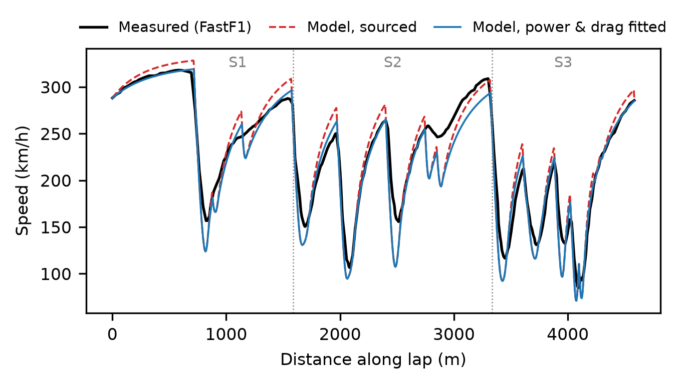
*Simulated vs measured speed on Leclerc's pole lap. Fitting power and drag (blue) brings the straights into line. The remaining error starts at the corners, where the model's "V shaped" minima fall below the measured "U shapes".*

## Key results
- **Lap time:** the model (using sourced parameters) is 2.86 seconds slower than Leclerc's pole lap, but it is too fast on the straights and too slow in the corners, so the errors partly cancel. Fitting power and drag from full throttle telemetry fixes the straights and the fit also works on Verstappen's lap, which it was not fitted to. The remaining 4.7 seconds is lost around the corners, which points to missing tyre physics in this model (load sensitive grip and load transfer) rather than wrong parameters.
- **Tyre degradation:** 0.146 seconds/lap on the Softs and 0.122 seconds/lap on the Mediums from 822 clean race laps. Held out stints are predicted to 0.68 seconds RMS against a benchmark of 0.99 seconds.
- **Strategy:** with a measured pit loss of 22.7 seconds, three stops emerges as the fastest by 1.1 seconds, with the first stop in laps 12–20. The window holds under ±20% degradation, but the number of stops does not.

## Contents
The project is split into 7 stages. The notebooks and this document are split into these sections:
1. [Setup and first speed trace](#stage-1-setup-and-first-speed-trace)
2. [Track geometry](#stage-2-track-geometry)
3. [Cornering-limit speeds](#stage-3-cornering-limit-speeds)
4. [Lap-time solver](#stage-4-lap-time-solver)
5. [Correlation against telemetry](#stage-5-correlation-against-telemetry)
6. [Tyre degradation](#stage-6-tyre-degradation)
7. [Race strategy](#stage-7-race-strategy)

## Repository layout
- `src/`: model code (track geometry, vehicle, solver, correlation, degradation)
- `notebooks/`: one notebook per stage of the project, with results
- `figures/`: plots

## Running it
Python 3.12. Install with `pip install -r requirements.txt`.
FastF1 downloads session data on the first run.

## Stage 1: Setup and first speed trace
*Loading FastF1 telemetry and plotting a first lap.*

Stage 1 was setting up the environment and getting used to FastF1 by plotting a first speed trace from the qualifying session of the 2022 British Grand Prix. However in Stage 2 it was swapped to the Spanish Grand Prix of the same year due to favourable conditions.

## Stage 2: Track geometry
*Turning noisy X/Y position data into corner radius along the lap.*

### Data choice

- **2022 Spanish GP qualifying, Leclerc's pole lap: 1:18.750 on Soft tyres.** Qualifying was dry and the race had no safety cars, which keeps stint data clean for stage 6 of this project. Barcelona also has long been a standard testing venue, with a mix of slow, medium and fast corners.
- The 2022 British GP was rejected due to its rain, which caused the fastest lap (1:39.1) to be 12 seconds off dry pace and so could not be used to correlate a dry-grip model.

### Method

1. **Raw position data** (`lap.get_pos_data()`) rather than merged telemetry. `get_telemetry()` linearly interpolates position onto car data timestamps, adding points that lie on straight lines between real samples. This creates artificial zero curvature segments.
2. **Units verified:** FastF1 X/Y are in decimetres. The polyline length divided by 10 agreed with FastF1's `Distance` channel.
3. **Arc length** Cumulative segment lengths found it to be 4,584 metres against the official 4,675 metres. This shortfall comes from the racing line cutting corners relative to the centreline the official measurement uses and from the partial first and last segments at the start and finish line.
4. **Resampled to uniform `ds = 2 m`.** Raw samples arrive at around 3.8 Hz, so 5–20 metres apart depending on speed. A finer grid adds no information. Noise in a second difference grows as 1/ds².
5. **Smoothing treated as a spatial low pass filtering problem** with a cut off wavelength `L`. Three filters were compared on two measured metrics:
   - **Noise:** standard deviation of κ through Turn 3, which is a long corner of near constant radius.
   - **Bias:** minimum radius at the final chicane, the slowest corner of the lap at 84 km/hr.
6. **Curvature** by central differences (`np.gradient`), using the full parametric formula, since smoothing changes `|dr/ds|`. Radius `r = 1/|κ|`, capped at 10 km on straights. The sign convention used was positive for left and negative for right, verified against Turn 1 (right), Turn 2 (left) and Turn 3 (right).
7. **Speed aligned to arc length by timestamp**, not by FastF1's `Distance` channel. The integrated arc length ends at 4,585.0 metres, while FastF1's `Distance` channel ends at 4,636.8 m, so `Distance` runs 51.7 metres or 1.13 % longer, as mentioned above.

### Smoothing comparison

| L [m] | Method | T3 std κ [1/m] | Chicane r [m] |
|---|---|---|---|
| 30 | Moving average | 0.00352 | 23.1 |
| 30 | Savitzky–Golay (cubic) | 0.00477 | 16.3 |
| 30 | Butterworth + filtfilt | 0.00418 | 17.4 |
| 40 | Moving average | 0.00331 | 27.5 |
| 40 | Savitzky–Golay (cubic) | 0.00408 | 18.6 |
| 40 | Butterworth + filtfilt | 0.00362 | 19.5 |
| **60** | Moving average | 0.00318 | 37.1 |
| **60** | Savitzky–Golay (cubic) | 0.00349 | 21.9 |
| **60** | **Butterworth + filtfilt** | **0.00323** | **21.3** |
| 80 | Moving average | 0.00314 | 49.7 |
| 80 | Savitzky–Golay (cubic) | 0.00323 | 23.5 |
| 80 | Butterworth + filtfilt | 0.00316 | 25.7 |

**Chosen: 4th-order Butterworth, zero-phase (`filtfilt`), L = 60 m.**

- **Noise floor:** all methods converge to a T3 standard deviation of about 0.0031, interpreted as real curvature variation through the corner. At L = 60, the Butterworth is within 0.0001 of that floor.
- **Knee in the bias:** the chicane radius rises slowly from L = 30 to 60, then jumps from 60 to 80. Beyond that point, the filter is removing real corner rather than noise.
- **Dominance:** at L = 60, the Butterworth beats Savitzky–Golay on both noise and bias.
- **Why not the moving average:** its sinc shaped frequency response rolls off slowly and flattens the corners. At L = 60 it gives a chicane radius of 37.1 metres against 21.3 metres. Without aero, cornering speed scales as √r, so that would make the simulated chicane around 32% too fast.
- **No ground truth:** taking the maximum of a noisy κ biases small-L radii low, and flattening biases large-L radii high. The chosen value sits in the stable middle and agrees with a hand estimate of about 20 metres from the raw samples at the apex.

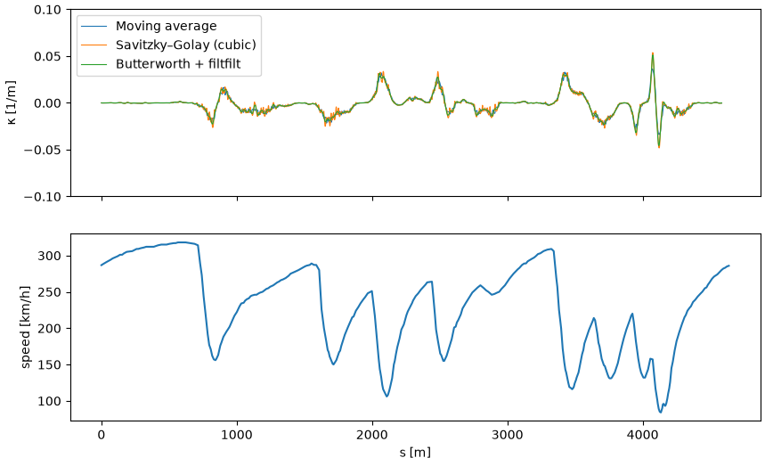

### Sanity check: implied lateral acceleration

Using `a = v²|κ|` with the measured speed:

- About 0 g on the straights.
- 2–3 g in slow corners. At the chicane: 84 km/h and r ≈ 21 m give about 2.6 g.
- 4–6 g in fast corners, with a peak of 6.2 g in Turn 9 (Campsa) at 258 km/h.

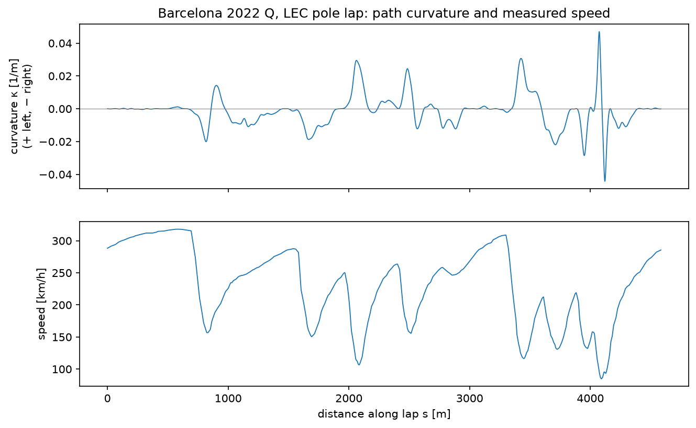

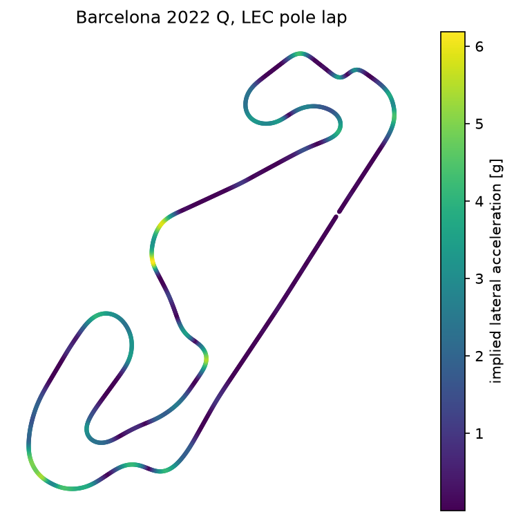

**Turn 9 shows two peaks (about 6 g) with a dip (about 3 g) between them at nearly constant speed.** I first suspected a sampling artefact, but the test rejected that. The raw samples are evenly spaced through the corner and the same shape appears in the same place on all the fastest laps of Leclerc, Verstappen, Sainz and Russell. It was concluded to be a feature of the racing line. Peak values across the four drivers range from 6.0 to 6.7 g, roughly ±5%, which gives an indication of lap to lap and driver to driver variability.

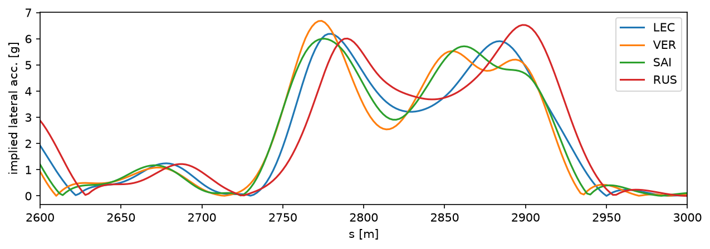

### Known limitations

- **Racing line, not centreline.** The geometry is specific to this lap and driver.
- **The lap is not a closed loop.** About 40 metres is missing at the start/finish line, which is visible on the track map. Filter edge effects fall on the main straight, where κ ≈ 0.
- **Fixed smoothing length.** `L` is fixed in metres, while raw sample spacing grows with speed, so fast corners are smoothed over fewer real samples than slow ones. Adaptive smoothing is a possible improvement.
- **Sensitivity to L.** The chicane radius ranges from 17 to 26 metres across L = 30–80 metres with the chosen filter. This uncertainty feeds directly into simulated corner speeds.
- **Sparse data at the slowest apex.** One sample gap at the chicane apex is about 11 metres against about 6 metres expected at that speed, which suggests a dropped sample.
- **2D only.** Elevation and banking are ignored.
- **Implied lateral acceleration uses measured speed.** Not every corner is taken at the grip limit (some are traction-limited on exit), so these are not grip limit values.
- **Cross driver agreement** rules out random sampling error, but not a position error common to all cars at the same place on track.

### Code

`src/track.py` contains the pipeline as small, tested functions: `raw_path`, `arc_length`, `smooth_path`, `curvature` and `track_geometry`. The notebook `notebooks/02_track_geometry.ipynb` shows the investigation step by step.

```python
from src.track import track_geometry
geo = track_geometry(lap)   # DataFrame: s, x, y, kappa, r, v, a_lat_g

```

## Stage 3: Cornering-limit speeds
*The fastest speed each corner allows, with downforce.*

### Method
At each point the cornering limit balances lateral demand against tyre grip,
including downforce:

    m·v²/r = μ_y·(m·g + ½·ρ·v²·C_L·A)

Because downforce grows with v², speed appears on both sides. Rearranging gives

    v_apex² = μ_y·g·r / (1 − r/r_crit),   r_crit = 2m / (μ_y·ρ·C_L·A)

i.e. the no-aero result √(μgr) multiplied by an aero amplification factor
1/√(1 − r/r_crit). For r ≥ r_crit grip grows faster than demand, so the corner
does not limit speed, `v_apex` returns `inf` there and the power/drag limit in
Stage 4 decides instead. This is implemented as a vectorised function in `src/vehicle.py`.

### Parameters (`src/params.py`)
| Parameter | Value | Source / assumption |
|---|---|---|
| m | 808 kg | 798 kg FIA 2022 minimum (car + driver, no fuel, Art. 4.1) + **assumed** 10 kg qualifying fuel |
| C_L·A | 6.1 m² (range 4.8–7.3) | Derived from Mercedes-AMG F1, *Downforce in Formula One, Explained* (2022): downforce = weight at ~150 km/h (7.33) and 3–4× weight at max speed (4.83–6.45, **assumed** 320 km/h). Midpoint taken. |
| μ_y | 1.6 (range 1.4–1.8) | OptimumG: warm slick on dry asphalt, 1.4–1.8 |
| ρ | 1.135 kg/m³ | Ideal gas law from FastF1 session weather at the lap (34.6 °C, 1002.9 mbar); humidity neglected |

The two Mercedes statements imply different C_L·A values, so a constant C_L·A is
itself a simplification, as ground effect downforce differs with ride height.

### Results
- With these parameters r_crit ≈ 146 metres. At the 21 metre final chicane aero raises
  v_apex by 8% over √(μgr); at 100 m by 78%.
- **The a priori model under predicts apex speed at every corner** of Leclerc's
  pole lap (1:18.750), measured speed exceeds the "limit" by 10–30%.
  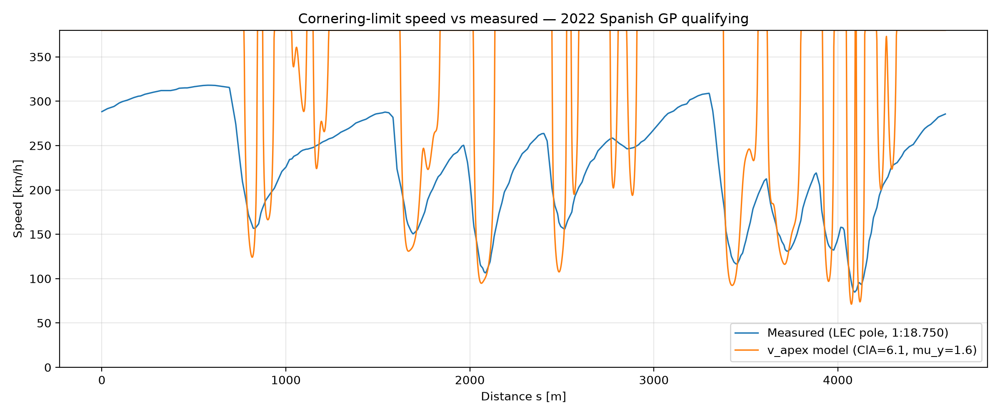
- **Grip identification.** At the limit, a_lat = μg + (μρC_L·A/2m)·v², a straight
  line in v². A least squares fit to 9 apexes from Leclerc's lap gives intercept
  A = 23.3 ± 2.2 m/s² (sourced: 15.7, +3.4σ) and slope
  B = 0.00696 ± 0.00108 m⁻¹ (sourced: 0.00686, +0.1σ). 
  The data agrees with the sourced aero grip gradient but need more zero speed grip.
  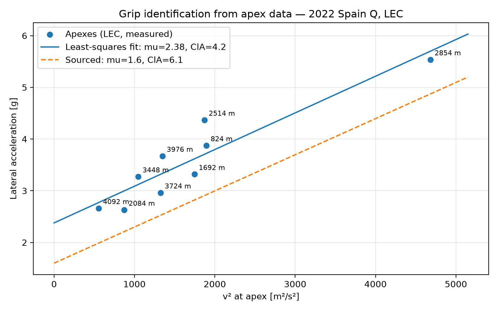
- **Validation on a held out lap** (Verstappen, 1:19.073, 8 corners): apex speed
  mean error −21.5 km/h with the sourced parameters, +2.3 km/h with the fitted
  parameters, RMS 25.8 → 14.9 km/h.
- The remaining error is **corner specific**: Leclerc's required μ at each corner
  correlates with Verstappen's prediction error at the same corner (r = −0.90).
- **Sensitivity** (one parameter at a time):
  - At the chicane, ±21% in C_L·A moves v_apex by ±2%; at T9 (86 m, 59% of
    r_crit), by ±15%.
  - At the chicane, the Stage 2 radius uncertainty (17–26 m → 62.6–80.2 km/h)
    exceeds the effect of the full μ range.

### Limitations
- μ and C_L·A are not separately identifiable from one lap (estimate correlation
  −0.83). Only A = μg and B = μρC_L·A/2m enter the point mass model and those
  are what the data constrain.
- The slope rests mainly on one high speed corner (T9). Without it,
  A = 19.3 ± 3.9 m/s² and B's uncertainty grows by 2.5 times.
- Validation covers slow and medium corners only (Verstappen's T9 was not
  detected as an apex) and it uses a different car as well as a different driver.
- Constant μ is assumed. Real tyres lose μ with load. T9, the highest load
  corner, has the lowest required μ (1.82), which is consistent with this but
  doesn't prove it.
- Corner specific residuals (~15 km/h RMS) are likely due to radius error, the
  2D track (no elevation or camber) and apexes that are not purely lateral
  (combined braking and traction).
- Lateral acceleration is implied from v²/r, not measured, because FastF1 has no
  accelerometer channel.

### Sources
- FIA 2022 Formula 1 Technical Regulations, Art. 4.1 (minimum mass)
- Mercedes-AMG F1, *Feature: Downforce in Formula One, Explained* (2022) — https://www.mercedesamgf1.com/news/feature-downforce-in-formula-one-explained
- C. Rouelle (OptimumG), slick tyre friction range, FSAE forum — https://www.fsae.com/forums/showthread.php?p=119223

## Stage 4: Lap-time solver
*Forward and backward passes to give a full simulated lap.*

### Method
- **Point mass quasi steady state (QSS) solver**, standard three pass method. Speed is integrated in distance using d(v²)/ds = 2a with forward Euler. Using v² as the state avoids dividing by v and is exact for constant acceleration.
- **Longitudinal limits** (`src/vehicle.py`):
  - **Friction ellipse:** lateral demand v²|κ| uses part of the tyre budget. Remaining longitudinal grip is μ_x·n·√(1 − (a_y/a_y,max)²), with n = g + ρ·ClA·v²/(2m).
  - **Power:** P_max/(m·v).
  - **Drag:** ½ρ·CdA·v²/m, subtracted when accelerating and added when braking.
- **Passes** (`src/solver.py`):
  - The forward pass (acceleration) starts from the measured speed at s = 0 and is clamped to v_apex at every point.
  - The backward pass (braking) runs the same integrator over the reversed track, starting from the measured end speed.
  - The solution is the element wise minimum. Brake points emerge where the forward and backward curves cross.
- **Lap time** is Σ ds / v_mid. The s grid covers 4,584 metres rather than the full lap, so the model is compared with **measured speed integrated on the same grid with the same quadrature** (LEC 77.835 seconds against the official 78.750 seconds). The 0.92 second difference is the missing start/finish distance and path shortening from smoothing, as mentioned in stage 2.
- **Two grip sets**, fixed before any lap was simulated:
  - **Sourced:** `CAR_2022`, from Stage 3.
  - **Identified:** `CAR_2022_FIT`, with μ_x = μ_y = 2.38 and ClA = 4.16 m², from the Stage 3 apex fit. With μ_x = μ_y the solver depends only on the well identified A = μg and B = μρClA/(2m), not on the unidentified μ/ClA split. **This set was fitted on Leclerc's lap, so its LEC lap time is not a prediction.** Verstappen's lap is the held out check.
- **Step size:** ds = 2 m. A halving study (8 → 0.5 m) shows first order convergence. Richardson extrapolation puts the discretisation error at 2 metres at **about +0.25 seconds** (explicit Euler evaluates downforce assisted braking at the slower end of each step).

### Results

| | LEC (77.835 s on grid) | VER (77.874 s on grid, held out) |
|---|---|---|
| **Sourced** | 80.690 s (**+2.855 s**, +3.7%) | 80.473 s (**+2.600 s**) |
| **Identified** | 71.930 s (−5.904 s, *fitted on this lap*) | 71.893 s (**−5.981 s**) |

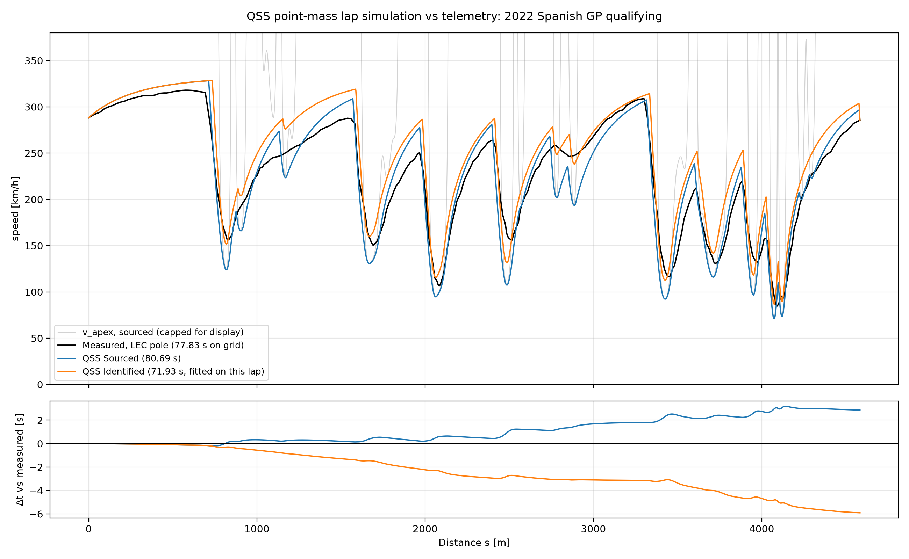

- **The sourced model's +2.9 s is the net of opposing errors.** The cumulative time delta steps up at every corner (apex speeds 10–30% low, as in Stage 3) and recovers part of that on every straight and braking zone. Slow exits also carry their penalty down the following straight, most visibly after T9.
- **With roughly correct corner grip, the model is about 4 seconds too fast.** Taking identified lateral grip with sourced μ_x = 1.6 gives 73.550 s (−4.285 s). This is a diagnostic run, not a parameter set. With μ_x ≠ μ_y the result depends on the unidentified μ/ClA split. μ_x accounts for 1.6 s of the 8.8 s between the two sets.
- **The over prediction is systematic.** It reproduces on a different driver and car (Verstappen) to within 0.3 s.

**Checks against telemetry (LEC):**

| | Top speed | Peak braking | Peak acceleration |
|---|---|---|---|
| Measured | 318.0 km/h (DRS open) | 5.90 g | 2.08 g |
| Sourced | 328.3 km/h | 7.74 g | 2.28 g |
| Identified | 328.6 km/h | 8.28 g | 2.58 g |

Measured accelerations come from d(v²)/ds on FastF1's 4–5 Hz speed channel, which smooths peaks, so measured peak braking is a slight underestimate.

### What correlates and what doesn't
- **Braking is over predicted by about 30%.** Constant μ (no tyre load sensitivity) gives too much grip at high normal load. ClA uncertainty alone does not appear to close the gap.
- **Mid to high speed acceleration and top speed are over predicted** even though the car had DRS open. Terminal speed depends only on P_max/CdA, so the data cannot say which value is wrong. A constant 670 kW with no ERS energy limit is the most likely cause.
- **Transferring the identified lateral μ to the longitudinal direction is contradicted by the data.** The identified set's acceleration and braking peaks both exceed Leclerc's.
- **CdA and P_max were not adjusted** to match top speed or lap time.

### Limitations
- Point mass: no load transfer, no yaw dynamics, no transient tyre behaviour.
- The traction limit uses all four tyres' load, though only the rears drive.
- Constant μ, ClA and CdA (no load sensitivity, no ride-height effects, no DRS), constant P_max (no ERS energy limit, no gear shifts).
- The model is a 2D track with no elevation or camber.
- Ferrari based parameters were used for the Red Bull validation lap.
- The open lap's measured speed boundary condition forces an artificial brake over the last few metres (visible at the end of the figure). A periodic boundary condition, solved by shooting on the start speed, would remove it.
- Explicit Euler introduces a small slow bias (about 0.25 s at 2 m). A second order scheme would reduce it.

## Stage 5: Correlation against telemetry
*Finding where and why the model differs from the real lap.*

### The rules that were set
- **Sourced parameters (`CAR_2022`) are never changed to match telemetry.** Every run that uses fitted values or changed physics is labelled **DIAGNOSTIC** and fitted values get their own names.
- **LEC's pole lap (1:18.750) is the reference.** Everything identified from telemetry is fitted on it. **VER's lap (1:19.073) is held out**: nothing is fitted on it, so it checks whether a fitted value transfers to another lap.
- Anything fitted on LEC is **not** a prediction of LEC's lap.

### Comparing like with like
- **Same grid, same quadrature.** The position derived grid ends at s = 4,584.0 m (LEC) and 4,566.0 m (VER), short of the full lap. The model is compared with measured speed integrated on the same grid (LEC 77.835 s, VER 77.874 s), not with the official time.
- **Sector lines mapped by session timestamp.** FastF1's sector session times are interpolated onto `s` through the raw position samples. S1|S2 and S2|S3 sit at 1,589.7 / 3,335.4 metres (LEC) and 1,581.1 / 3,328.6 metres (VER), within 9 metres of each other. The start/finish line itself lies outside the position data (LEC: 0.160 seconds before the first sample and 0.030 seconds after the last).
- **Shared helpers moved to `src/correlation.py`** and regression checked against notebooks 03/04 (77.835 seconds, 80.690 seconds, apex table identical row for row). `channel_on_grid` puts any telemetry channel (Throttle, Brake, DRS) on the grid with the same timestamp alignment as `track_geometry`. On Speed it reproduces the geometry's speed to 1e-14.

### Sector times

| | S1 | S2 | S3 | Lap |
|---|---|---|---|---|
| LEC official | 22.004 | 29.410 | 27.336 | 78.750 |
| LEC measured (grid) | 21.684 | 29.279 | 26.872 | 77.835 |
| **LEC model, sourced** | 21.824 | 30.938 | 27.928 | 80.690 |
| LEC model, identified grip (fitted on LEC) | 20.279 | 27.508 | 24.143 | 71.930 |
| VER official | 21.978 | 29.684 | 27.411 | 79.073 |
| VER measured (grid) | 21.570 | 29.530 | 26.774 | 77.874 |
| **VER model, sourced** | 22.048 | 30.792 | 27.633 | 80.473 |
| VER model, identified grip (held out) | 20.417 | 27.431 | 24.045 | 71.893 |

- **The sourced model minus measured:** LEC +0.14 / +1.66 / +1.06 s (lap **+2.86 s**); VER +0.48 / +1.26 / +0.86 s (lap **+2.60 s**).
- **S2 is the worst sector for both drivers.** It contains the two largest apex speed deficits (2,514 m: 113 vs 156 km/h. T9: 207 vs 246 km/h). S1's small error turns out to be cancellation (see zone attribution).
- **Absolute time bias (affects absolute times only, not model vs measured).** After allowing for the uncovered lap ends, measured on grid times are still quicker than official. S2, fully covered, is 0.13 s (0.45 %) quick. The twisty S3 is 0.43 s (1.6 %) quick. This is not a uniform path length error and likely causes are smoothing shortening the path through corners and linear interpolation of 4–5 Hz speed flattening speed dips. Both model and measured use the same grid, so the comparison is unaffected.

### Zone attribution
- Each grid point is labelled by what limits the **model** there: **cornering** (at v_apex), **braking** (backward pass active), **acceleration grip limited** or **power limited**.
- Δt per segment is split **half to the zone at each end**, because the boundary segments (brake points, apexes) carry the largest Δt. Labelling by the start point alone moved 0.23 seconds between zones. The spread between start only and end only labelling is reported as ±.

| Δt (s), model − measured | cornering | braking | accel (grip) | accel (power) | total |
|---|---|---|---|---|---|
| LEC sourced | +0.18 | +2.66 ± 0.12 | +1.39 ± 0.09 | −1.38 ± 0.02 | +2.86 |
| LEC identified grip | +0.03 | −0.33 ± 0.06 | −0.52 ± 0.05 | −5.08 ± 0.01 | −5.90 |
| VER sourced | +0.19 | +2.97 ± 0.12 | +1.21 ± 0.10 | −1.77 ± 0.02 | +2.60 |
| VER identified grip (held out) | +0.05 | −0.11 ± 0.07 | −0.44 ± 0.06 | −5.48 ± 0.01 | −5.98 |

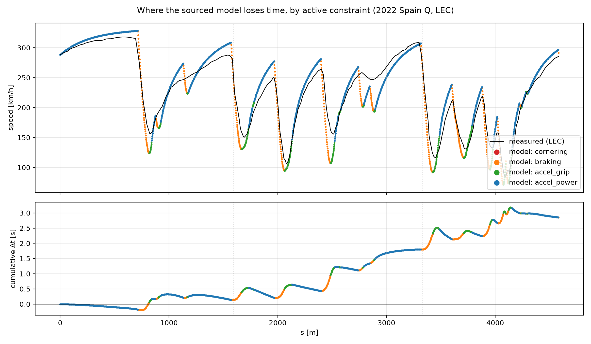

- **Location is not cause.** A QSS car has an apex *point*, while the measured speed minima are "U shaped". So the model's cornering error appears in the **braking and exit zones either side of the apex**, not in the "cornering" zone (only 15 grid points). The model brakes down to a too low apex despite over strong braking.
- The sourced lap's +2.86 seconds is a slow corners error that is **partly cancelled** by over fast straights (power zones −1.38 s).

### Sensitivity (LEC, sourced, one parameter at a time across its sourced range)

| Parameter (range) | Δlap at low end | Δlap at high end |
|---|---|---|
| μ_y (1.4–1.8) | +5.29 | −4.16 |
| ClA (4.8–7.3 m²) | +4.17 | −3.37 |
| CdA (1.0–1.8 m²) | −1.33 | +0.82 |
| P_max (650–750 kW) | +0.28 | −1.00 |
| μ_x (1.5–1.7) | +0.41 | −0.36 |
| m (803–818 kg) | −0.14 | +0.28 |

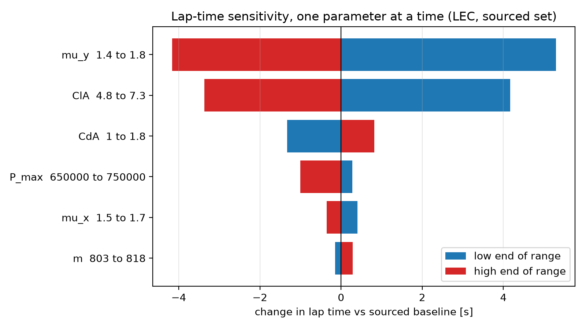

- **Lateral grip dominates:** μ_y > ClA > CdA > P_max ≈ μ_x > m.
- **ClA or μ_y alone, within its sourced range, could match the lap time. This was not done**, because it would leave straights and braking wrong (it is the tuning trap).
- The low ends cost more than the high ends gain, because t = ∫ds/v is convex in v.
- **Top speed fixes only P/CdA**, since it scales as (P/CdA)^(1/3). Peak braking tracks **entry speed**, because downforce ∝ v². No single parameter in range brings the model's 7.7 g peak braking down to the measured 5.9 g (lowest: 6.7 g).

### DIAGNOSTIC 1: effective power and drag from the straights
- On a straight at full throttle, a·v = P/m − (ρCdA/2m)·v³ is **linear in the unknowns**, the same idea as Stage 3's apex fit.
- Least squares on segments with **throttle ≥ 99 % at both ends, v > 150 km/h, r > 500 m**. Points are never selected on acceleration itself.

| | Segments | Speed range | DRS open | P_eff | CdA_eff | Terminal speed |
|---|---|---|---|---|---|---|
| LEC (fit) | 896 | 172–318 km/h | 65 % | 511 kW | 1.23 m² | 324 km/h |
| VER (check) | 890 | 161–321 km/h | 65 % | 476 kW | 1.06 m² | 332 km/h |

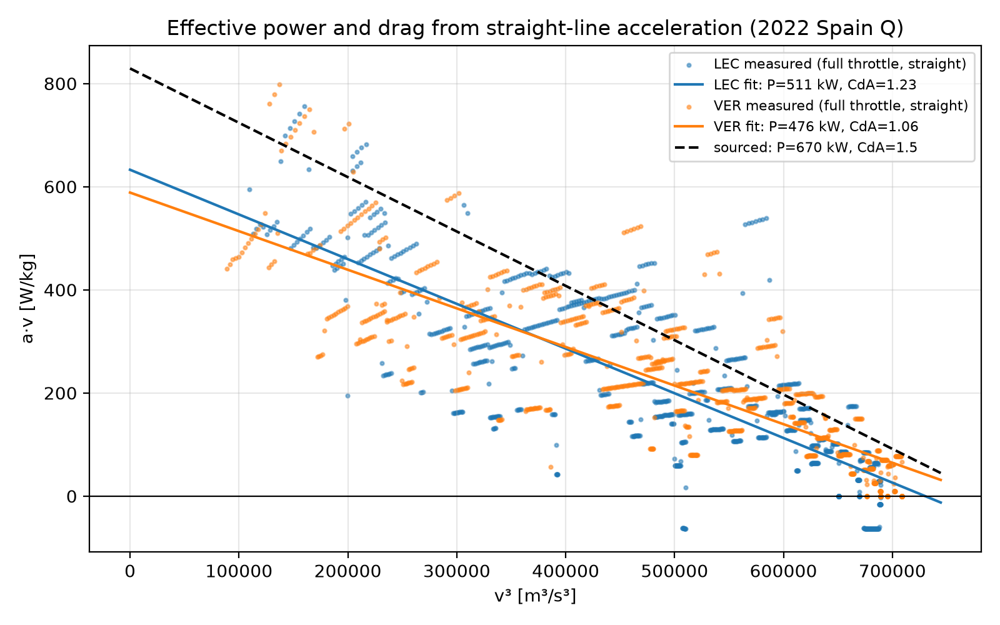

- **Caveats:**
  - polyfit standard errors (±9 kW, ±0.03 m²) are about 3× too small, because interpolated 4–5 Hz samples are not independent.
  - P and CdA estimates are correlated.
  - CdA_eff mixes DRS open and DRS closed running.
  - P_eff absorbs drivetrain losses, ERS deployment limits, gear shifts and gradient.
- Low speed points sit above the fitted line, close to the sourced 670 kW, which hints that power is not constant along a straight (ERS taper).
- **A constant 670 kW at the wheels is not supported.** Re solving with LEC's P_eff/CdA_eff (`pd_fit`):

| Run (DIAGNOSTIC) | Δlap | Top speed | cornering / braking / grip / power |
|---|---|---|---|
| LEC sourced + pd_fit | +4.67 s | 319 km/h | +0.18 / +2.77 / +1.39 / +0.33 |
| **VER sourced + pd_fit (held out)** | **+4.50 s** | 320 km/h | +0.20 / +3.09 / +1.27 / **−0.06** |

- **With straight line performance identified from telemetry, the sourced model is about 4.5–4.7 s slow, essentially all of it around the corners.** On the held out lap the power zones come to −0.06 s.

The speed trace at the top of this README shows this run against the sourced model and the measured lap (made in the last cell of `notebooks/05_correlation.ipynb`).

### DIAGNOSTIC 2: rear wheel drive traction bracket
- The Stage 4 model applies tractive force through all four tyres (AWD, upper bound).
- A rear wheel drive limit **without load transfer** gives the lower bound. Traction is scaled by the rear axle's share of normal load:
  - share = (w_rear·g + aero_rear·k·v²)/(g + k·v²), with k = ρClA/2m.
  - stored separately as `RWD_2022` so `CAR_2022` is unchanged.
  - static rear weight 0.5475 (FIA 2022 Formula 1 Technical Regulations, Art. 4.2 axle minimums; range 0.54–0.555 from G. Anderson, The Race).
  - rear aero share 0.57 (range 0.54–0.60: 0.54 puts the centre of pressure at the centre of gravity, from a Durham University paper; 0.60 from G. Anderson's analysis in The Race).
- **Centre of gravity height has no reliable public source**, so longitudinal load transfer is not modelled. The bracket stands in for it.

| Run (+ pd_fit, DIAGNOSTIC) | AWD Δlap, peak accel | RWD Δlap, peak accel |
|---|---|---|
| LEC sourced | +4.67 s, 2.03 g | +6.83 s, 1.40 g |
| VER sourced (held out) | +4.50 s, 2.10 g | +6.63 s, 1.40 g |

- **Measured peak acceleration (LEC 2.08 g, VER 2.03 g) lies between the RWD and AWD bounds**, as expected if load transfer is the missing piece.
- Varying the weight and aero balance inputs across their ranges moves the result by 0.36 seconds, much less than the 2.15 seconds from the AWD to RWD shift, so the conclusion does not depend on the weakest source.
- **The exits are in the wrong regime.** Where the model is power limited below 150 km/h, LEC is **never** at full throttle and is still turning (78–89 % of those points are curved). The model accelerates where the driver is traction and balance limited.

### DIAGNOSTIC 3: braking at matched speed and curvature
- **A straight line fit of −a = μ_x·g + c·v² was not possible.** Only 8 of 184 settled braking points have r > 500 m and braking zones last 0.6–1.8 s (3–8 raw samples).
- Instead, measured deceleration was compared with the model's `a_brake(v, κ)` **at each point's own speed and curvature**, brake on at both segment ends, ≥ 0.3 s after brake onset (to skip the pressure ramp), above 100 km/h.
- **Above 200 km/hour, the car decelerates at about 0.7 of the sourced model's available braking:**
  - LEC 0.67–0.71, VER 0.70–0.73 (held out);
  - stable for onset thresholds 0.15–0.5 s, except VER at 0.5 s (1.05, n = 12, points nearer the apex);
  - measured points sit inside both the sourced and identified g-g envelopes.

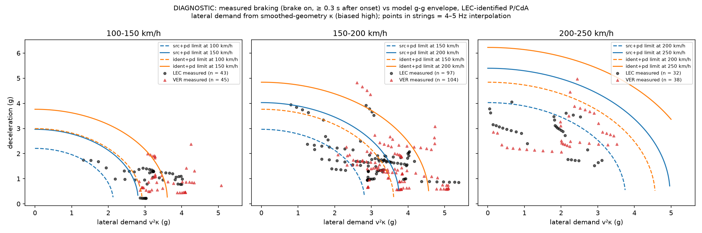

- **Caveats:**
  - Lateral demand v²κ uses smoothed geometry curvature. Curvature noise rectifies and inflates it, some points exceed the identified pure lateral limit while braking. **Low speed comparisons are therefore not reliable.** The bias only pushes points outward, so the high speed "inside the envelope" result holds in direction.
  - Interpolation lowers measured deceleration, while curvature noise lowers the model's available braking. ~0.7 is indicative, not a measured constant.
  - Points appear in strings (one raw sample interval each), so n overstates the independent information by about 5×.
- **Consistent explanations:** load sensitive μ; brake balance / stability limits that ideal four wheel QSS braking ignores; μ_x < μ_y. This data cannot separate them.
- **Implication:** the model's over strong high-speed braking hides part of its corner deficit, another reason not to fix grip with a single parameter.

### Headline

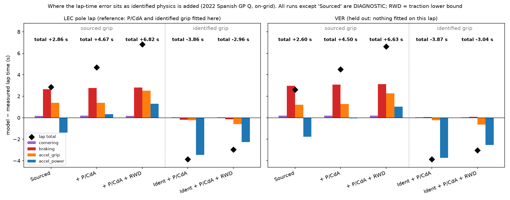

| Run | LEC Δlap | VER Δlap (held out) |
|---|---|---|
| Sourced (prediction) | +2.86 s | +2.60 s |
| + identified P/CdA | +4.67 s | +4.50 s |
| + RWD traction (lower bound) | +6.83 s | +6.63 s |
| Identified grip + P/CdA | −3.86 s | −3.87 s |
| Identified grip + P/CdA + RWD | −2.96 s | −3.04 s |

All runs except "Sourced" are DIAGNOSTIC.

### Diagnosis
1. **Prediction.** With sourced parameters the model is +2.86 s slower than LEC's pole lap on the same grid (+2.60 s against VER). S2, with the two largest apex deficits, carries the most.
2. **The headline error hides a cancellation.** The model is 1.4–1.8 s too fast on the power limited straights. Effective power and drag identified from full throttle telemetry (511 kW, 1.23 m²) remove that error and transfer to the held out lap (power zones −0.06 s). With straights corrected, the sourced model is **+4.7 s slow, almost entirely around the corners**.
3. **Corners.** Apex speeds are 10–30 % low, so sourced lateral grip is under predicted. A QSS car has an apex point, so the deficit is booked to braking and exit zones.
4. **Exits.** Below 150 km/h the model is power limited where the driver is never at full throttle. Rear wheel drive traction (lower bound) adds 2.2 s, and measured peak acceleration lies between the RWD and AWD bounds. Longitudinal load transfer is missing and it needs a CoG height that could not be sourced.
5. **Braking.** Above 200 km/h the car uses about 70% of the model's available braking. The model's over strong braking hides part of its corner deficit.
6. **Identified grip over corrects.** μ = 2.38 fitted to LEC's apexes makes the car 3.9 s too fast, mostly on exits and is contradicted by measured peak acceleration and braking.

**Conclusion.** The power train and drag can be identified from telemetry and transfer to a held out lap. The remaining error comes from the tyre model. One constant μ shared by both axes, ideal four wheel braking and no load transfer cannot describe corners, exits and braking together. The next change is to implement **load sensitive grip with load transfer**, which is a change to the model, not to its parameters.

### Limitations
- **Two laps, one circuit, one session.** VER is a different car, so agreement there shows transfer, not validation of LEC's car.
- **4–5 Hz position and speed data**, linearly interpolated onto a 2 m grid. Peaks are underestimated and fitted standard errors are optimistic.
- **Curvature from smoothed positions** is noisy near corner entries and biases lateral demand high.
- **Identified values are effective values.** They absorb everything the point mass model leaves out (ERS strategy, DRS, drivetrain losses, gradient, driver behaviour).
- **Discretisation:** forward Euler at ds = 2 m carries about +0.25 s (Stage 4).
- **Lap ends:** the solver's end boundary condition forces the measured end speed, which causes a short artificial braking event at s ≈ 4,584 m.

## Stage 6: Tyre degradation
*Fitting how lap time grows with tyre age, checked on held out stints.*

**Data.** 2022 Spanish GP race (66 laps, 20 drivers, 1,230 laps driven), FastF1 lap timing only. This race was chosen as there is no safety car or VSC (after checking all track status and all 111 race control messages). There were yellows on lap 1 and laps 6–9. Compounds were C3 (Soft), C2 (Medium) and C1 (Hard) [3]. Only Magnussen used the Hard, for laps 30 to 64.

**Cleaning.** Rules applied in order, with counts. All except the last are independent of lap time:

| Rule | Laps left | Dropped |
|---|---|---|
| Start | 1,230 | |
| Not lap 1 | 1,210 | 20 |
| Not an in-lap / out-lap | 1,104 | 53 + 53 |
| Green all lap (TrackStatus = '1') | 1,060 | 44 |
| Not deleted (track limits) | 1,046 | 14 |
| FastF1 IsAccurate | 1,046 | 0 |
| Clear air: gap to car ahead at the line ≥ 1.5 s (any car, any lap) | 823 | 223 |
| Within 107 % of driver's median (dependent variable) | 822 | 1 |

**Model.** Pooled least squares with driver fixed effects:
t = d_driver + b_compound + c·LapNumber + k_compound·TyreLife
(Soft is the baseline compound. 26 parameters. Solved with `np.linalg.lstsq`).
Within one stint, lap number and tyre age rise together, so only c + k is identifiable from a single stint. They separate across stints, because tyre age resets at a stop while lap number does not. The pooled design has full rank (26/26). The estimated correlations of c with each k are only −0.13 to −0.35.

**Results** (36 laps from two final stints held out. Ranges across cleaning variants were traffic threshold 1.0 / 1.5 / 2.0 s, with and without the outlier rule, plus a gap behind (blue flag) filter):

| Parameter | Baseline | Range | Note |
|---|---|---|---|
| c, fuel + track (s/lap) | −0.050 | −0.047 to −0.052 | |
| k Soft (s/lap of age) | 0.146 | 0.144 to 0.151 | |
| k Medium | 0.122 | 0.119 to 0.131 | |
| k Hard | 0.161 | 0.156 to 0.166 | one stint, one driver |
| b Medium vs Soft (s) | +0.57 | +0.54 to +0.63 | |
| b Hard vs Soft (s) | +0.60 | +0.38 to +0.87 | poorly determined |

Residual RMS is 0.65 seconds. Standard errors from the fit (e.g. ±0.006 s/lap on k Medium) assume independent laps, so they are optimistic. The ranges above are the better guide to uncertainty.

**Correlation with the vehicle model.** The QSS model's mass sensitivity (0.028 s/kg, Stage 5) times an assumed burn rate of 1.5–1.7 kg/lap predicts a fuel effect of −0.042 to −0.048 s/lap. The fitted c (−0.047 to −0.052) agrees to within around 10%. That implies net track evolution of roughly 0 to −0.01 s/lap, which is small. Rubbering in and rising track temperature may cancel and this data cannot separate them.

**Interpretation via the model (not a measurement).** Using the Stage 5 sensitivity dt/dμ_y ≈ −23.6 s per unit μ, the degradation rates correspond to a lateral grip loss of about 0.3–0.4 % of μ per lap (Soft 0.0062, Medium 0.0052 per lap).

**Checks.** Residuals against tyre age are flat for Soft and Medium within the observed ages, so linear degradation is adequate there. Teams pit before any cliff, so the data says nothing beyond about 24 laps (Soft) or 35 laps (Medium). Residuals against lap number are flat to ±0.3 s over laps 5–60, but rise to about +1 s over the final laps (the cause was not identified, could be managing, lapped traffic, saving, etc.).

**Predicted vs measured stint pace** (held out stints chosen by rule before fitting. Final stints of VER and of the P7–12 finisher with the most clean laps (VET), each with ≥ 10 clean laps. The benchmark was driver's median training lap):

| Stint | Laps | Bias (s) | RMS (s) | Benchmark RMS (s) | Slope measured / predicted (s/lap) |
|---|---|---|---|---|---|
| VER, Medium, laps 46–66 | 18 | +0.61 | 0.66 | 0.51 | 0.067 / 0.072 |
| VET, Medium, laps 45–65 | 18 | +0.04 | 0.70 | 1.30 | 0.003 / 0.072 |

Combined RMS is 0.68 s (benchmark 0.99 s), close to the fit's own 0.65 s. The two stints fail in complementary ways:
- **VER: slope right, level 0.6 s off.** VER has no clean Medium laps in training, so his Medium pace comes from the field average offset. The offset was already present while he was building his lead (laps 49–53), which argues against pace management as the main cause. This points to a missing driver/car times the compound term.
- **VET: level right, but flat where the model predicts +0.072 s/lap.** This points to car to car variation in degradation, which a single k per compound cannot capture.

On VER's stint the model is worse than the naive benchmark. That is reported, not hidden.

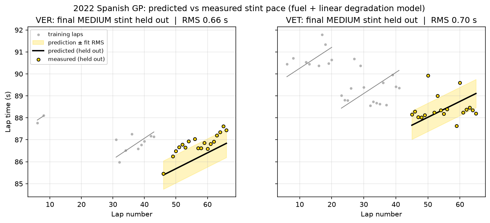

**Limitations:** 
- One degradation rate per compound for the whole field. 
- No driver times compound term. 
- Linear in lap number and tyre age. 
- Hard from a single stint. 
- Traffic judged only at the line. 
- Both of the held out stints were on Mediums, so the Soft prediction is untested.
- Fuel burn rate was assumed, not measured.
- The outlier rule's driver medians include the held out laps (but this affects at most one lap).

**Figures.** `figures/06_coverage.png` (laps by lap number and tyre age: why c and k separate), `06_clean_laps.png`, `06_residuals.png`, `06_stint_prediction.png` (headline, below).

**Code.** `src/degradation.py` (cleaning, design matrix, fit); `notebooks/06_tyre_degradation.ipynb`.

## Stage 7: Race strategy
*Searching every pit stop strategy and testing how robust the answer is.*

### Method
- **Strategy cost.** Race time = Σ over laps (d + b_compound + c·L + k_compound·age) + N·P.
  The driver term and the fuel/track term c·L are identical for every strategy, so they cancel.
  In this additive model, fuel burn cannot change which strategy wins. A stint of n laps
  starting at tyre age a₀ costs n·b + k·(n·a₀ + n(n−1)/2) (forming an arithmetic series).
- **Pit loss P**, measured, not assumed. For each green flag stop,
  (in-lap + out-lap) − model prediction for the same two laps on the old and new tyres.
  51 stops (Excluding Hamilton and Magnussen's lap 1 stop under yellow flag).
  **Median 22.7 seconds, IQR 21.9–23.6 seconds.** About 0.9 seconds of the spread is model error
  (√2 × the 0.65 s lap RMS). The median is used rather than the mean because a few outlying stops (STR, MAG) would distort the mean.
- **Search.** Every set of stop laps for 1–4 stops (C(65, n) sets), each stint given its
  cheapest compound, with an exact fix for the two compound rule. Checked against a separate
  full brute force over all compound sequences, which reproduced the results exactly.
  Rules state at least two compounds. No stint beyond the oldest tyre age in the data
  (Soft 24, Medium 35, Hard 35), so **no extrapolation**.
- **Tyre sets.** In 2022 each driver had 8 Soft, 3 Medium and 2 Hard sets [1], and the
  rule forcing top 10 qualifiers to start on their Q2 tyres had been dropped [2].
  Most Soft stints in the race started on sets already 3–4 laps old (from qualifying),
  so all new sets and used Softs (a₀ = 4) were the two scenarios ran.

### Results
| Stops | All new sets (s) | Used Softs (s) |
|---|---|---|
| 1 | 217.86 (M35/H31) | 217.86 |
| 2 | 162.40 (S/S/M, 22 laps each) | 178.13 (S20/M23/M23) |
| 3 | **158.05** (S/S/S/M, 17/17/17/15) | **177.01** (S15/M17/M17/M17) |
| 4 | 164.17 | 185.79 |

Costs are relative (common terms removed), only differences mean anything.
- **Three stops is optimal** in both scenarios: by 4.35 s (new) and **1.12 s (used Softs)**.
  A back of envelope estimate (optimum stops ≈ L·√(k/2P) − 1 ≈ 2.5) predicted it would be marginal.
- **Stop window (used Softs):** a three stop's first stop anywhere in laps **12–20** is within
  1 second of the best. A two stop is in 18–26. The curves cross at about lap 21
  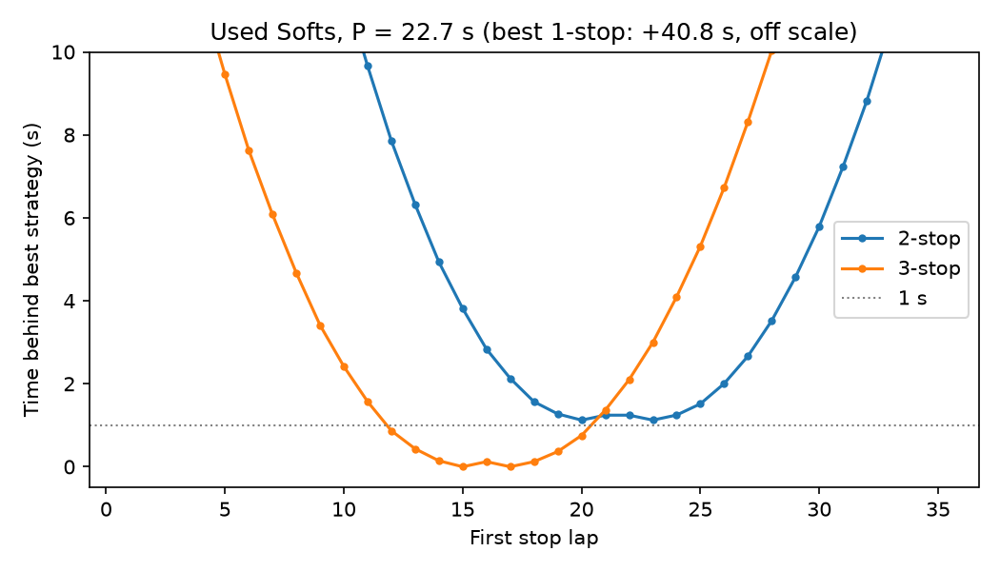
- **Compound order doesn't matter** in this model (no fuel times tyre interaction), so several
  orders tie. Order is set by things the model doesn't contain. For example, which tyres a driver starts on after qualifying, or track position at a stop (the undercut).

### Sensitivity
P can only change the number of stops, never the window. Every 'n' stop strategy shifts by n·P.
So the 2 vs 3 stop tie point is exact, P_tie = P + (best 2-stop − best 3-stop).

| Scenario | k × 0.8 | k × 1.0 | k × 1.2 |
|---|---|---|---|
| Used Softs: P_tie (s) | 20.2 (**2 stops**) | 23.8 | 29.2 |
| New sets: P_tie (s) | 22.4 (≈ tie) | 27.1 | 31.7 |

- The **window is robust** (first stop in laps 11–21 in every case). The **number of stops is not**,
  a 20 % change in degradation flips it. 
  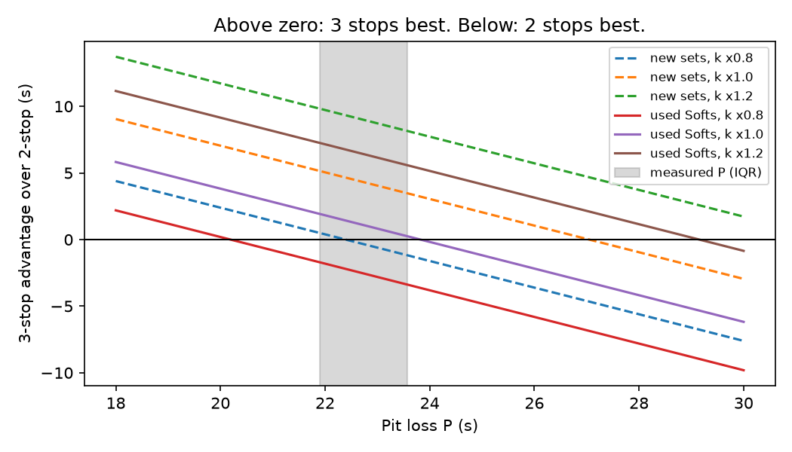
- In the "as raced" scenario, P_tie (23.8 s) lies just above the measured IQR.
- b_Medium's range (±0.05 s/lap) moves the 2 vs 3 stop margin by only about ±0.25 seconds,
  b_Hard is irrelevant (the Hard is only chosen when forced).
- Four stops never wins, even with the most favourable combination (k × 1.2, P − 2 s), giving +1.2 s / +3.7 s.

### Comparison with what teams ran
- Lead lap finishers vs the used Softs optimum return RUS +1.7 s, PER +2.3, VER +3.3, SAI +7.1,
  BOT +9.3 (two-stop), HAM +21.8 (lap 1 stop for a puncture after contact with Magnussen). OCO and NOR started on **new**
  Softs, so the used Softs optimum isn't their benchmark (they come out at −1.2 and −0.7 s).
- **Most teams ran three Soft stints and one Medium. The model's optimum uses three Mediums.**
  With only 3 Medium sets per weekend, a cap on Medium stints was tested (no parameters changed):
  - at most 1 Medium: best is a **three stop with three Softs + one Medium** (16/18/16/16),
    the shape 8 of 20 drivers ran;
  - at most 2: two and three stops tie (within 0.13 s), and teams split between them.
  That teams had only one new Medium left is an **inference consistent with the data,
  not verified**. This could be checked using FastF1's FreshTyre and TyreLife data across practice and qualifying to count how many new Medium sets each driver had left.
- Other things the model can't see include traffic and the undercut, track position,
  safety car probability, car specific degradation (VET's held out stint was almost flat),
  and Hard parameters from a single stint.

### Simplifications
- Additive model (no fuel times tyre interaction)
- One k per compound (field average)
- Linear degradation within the observed ages, no cliff
- Fixed pit loss; no traffic, undercut or safety car.
- Set availability only through the a₀ scenarios and the Medium cap.

[1] Formula1.com, "What tyres will the teams and drivers have for the 2022 British Grand Prix?" (same allocation as Spain).
[2] Autosport, "F1 regulations update confirms removal of Q2 tyre rule".
[3] Pirelli, "2022 Spanish Grand Prix – Preview".